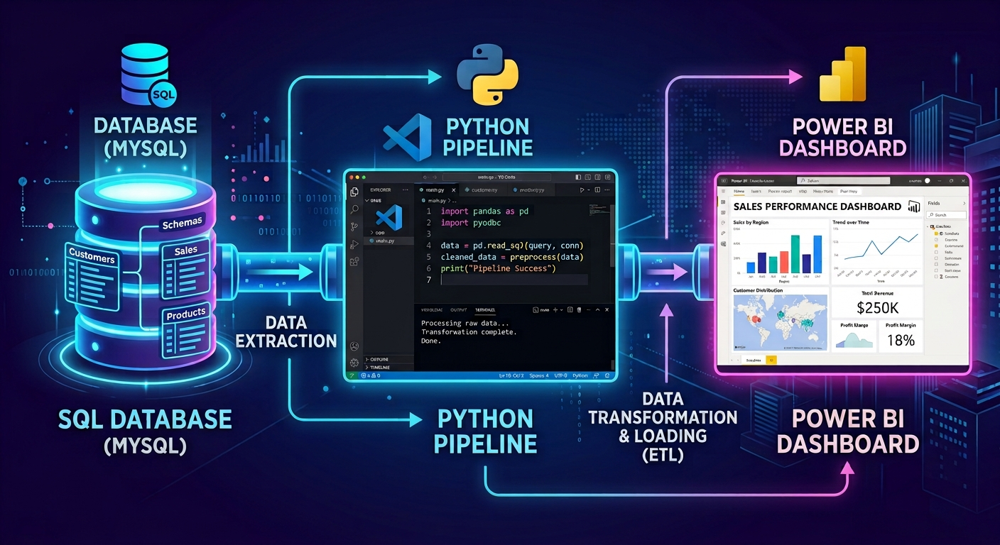

# Flujo de datos de SQL > Python > PowerBi — Olist Marketplace 🛒

## 📝 Descripción del Proyecto

Este proyecto aborda la extracción, modelado y limpieza de los datos transaccionales del marketplace brasileño **Olist** (2016–2018). El objetivo principal consiste en transformar un modelo de datos relacional y transaccional (OLTP) en un **conjunto de datos analítico (OLAP)** optimizado para responder a preguntas clave de negocio, automatizaciones ETL y la posterior construcción de cuadros de mando analíticos. Con estos datos se generarán un Dashboard que muestre el estudio realizado.

El flujo de trabajo se divide en tres grandes bloques:
1. **Modelado y limpieza en SQL:** Creación de dataframes exploratorios y definición de una consulta analítica estandarizada y agregada.
2. **Procesamiento y limpieza final en Python:** Validación de tipos, tratamiento de atípicos, ingeniería de características y exportación optimizada.
3. **Importación a PowerBi y creación del Dashboard:** Implementación de medidas y gráficos.

---

## 👥 Equipo e Integrantes

* **Integrantes del equipo:**
  * Carol Rueda
  * Anthony Rodriguez
  * Miguel López

---

## 📌 Definición estratégica de los Dataframe usados

### Dataframe 1: Actividad clientes

> **Grano declarado:**  
> **«Una fila por order_id (nivel de pedido individual).»**
> ** **
> **Columna clave:**  
> **«order_id (y agrupado por customer_unique_id para métricas de clientes).»**

### Dataframe 2: Catalogo de productos

> **Grano declarado:**  
> **«Una fila por ítem dentro de cada pedido (order_id + order_item_id implícito en la relación).»**
> ** **
> **Columna clave:**  
> **«product_id combinado con seller_id.»**

### Dataframe 3: Vendedores y popularidad

> **Grano declarado:**  
> **«Una fila por cada combinación de seller_id y product_id.»**
> ** **
> **Columna clave:**  
> **«seller_id y product_id.»**

### Dataframe 4: Tabla de hechos

> **Grano declarado:**  
> **«Nivel de línea de pedido (order_id + order_item_id).»**
> ** **
> **Columna clave:**  
> **«Claves foráneas hacia las dimensiones de clientes, productos y vendedores.»**

---

## 🎯 KPIs y Métricas de Negocio

El dataset preparado permite monitorear y evaluar los siguientes Indicadores Clave de Rendimiento (KPIs):

1. **Promedio de dias de entraga:** Frecuencia con la que un paquete es entregado.
2. **Puntuación media de las reseñas:** Nota media que los clientes dan sobre los productos adquiridos.
3. **Tasa de retraso:** Porcentaje de pedidos que se entregan con retraso a la fecha estimada.
4. **Total de ingresos:** Monto total de las ventas realizadas.

---

## 🗂️ Estructura del Repositorio

```
.
├── assets/                             ← agregados al proyecto
│   └── banner_p5.jpg
│
├── dashboard/                          ← ficheros finales de entrega
│   ├── OLD_Olist_Dashboard.pbix          version old
│   ├── OLD_Olist_Dashboard.xlsx          version old
│   ├── Olist_Dashboard.pbix      
│   └── Olist_Dashboard.xlsx
│         
├── data/                               ← csv exportado
│   ├── df1_actividad_clientes.csv
│   ├── df2_catalogo_productos.csv
│   ├── df3_vendedores_popularidad.csv
│   └── df4_tabla_hechos.csv
│
├── notebooks/
│   └── limpieza.ipynb                 ← fichero para pruebas de codigo
│         
├── sql/                               ← consultas en workbench
│   ├── df1_actividad_clientes.sql
│   ├── df2_catalogo_productos.sql
│   ├── df3_vendedores_popularidad.sql
│   └── df4_tabla_hechos.sql
│
├── src/                               ← el código, en VS Code
│   ├── __init__.py                      init
│   ├── config.py                        lee las credenciales del .env
│   ├── excel.py                         operaciones en excel
│   ├── limpieza.py                      limpieza de datos en py
│   └── Olist_ETL.py                     enlace con workbench
│
├── .env                               ← vuestras credenciales.
├── .env_example                         plantilla del anterior
├── .gitignore
├── main.py
├── README.md                         
└── requirements.txt
```

---

## 🚀 Instrucciones de Ejecución

1. **Configuración de la Base de Datos (MySQL)**
   * **Descargar e importar el archivo olist.sql** en tu gestor de base de datos MySQL local:

   Descarga el volcado y cárgalo en tu MySQL local:

   📥 **[olist.sql.gz](https://drive.google.com/drive/folders/1apSXjn6eQ5o9RdutbD4skSjvH6ytvR06?usp=sharing)** · 46 MB comprimido, 145 MB al descomprimir

   ```bash
   # Windows (PowerShell), tras descomprimir con 7-Zip:
   mysql -u root -p < olist.sql
   ```

   Tarda unos minutos: son **1.550.922 filas**. Al terminar tendrás la base `olist` con 9 tablas.

   ### ✅ Comprueba que cargó bien

   Antes de empezar, ejecuta esto. Las nueve tablas deben coincidir:

   ```sql
   USE olist;

   SELECT 'categoria_traduccion' t, COUNT(*) filas, 71      esperado FROM categoria_traduccion
   UNION ALL SELECT 'products',       COUNT(*),      32951   FROM products
   UNION ALL SELECT 'sellers',        COUNT(*),      3095    FROM sellers
   UNION ALL SELECT 'customers',      COUNT(*),      99441   FROM customers
   UNION ALL SELECT 'geolocation',    COUNT(*),      1000163 FROM geolocation
   UNION ALL SELECT 'orders',         COUNT(*),      99441   FROM orders
   UNION ALL SELECT 'order_items',    COUNT(*),      112650  FROM order_items
   UNION ALL SELECT 'order_payments', COUNT(*),      103886  FROM order_payments
   UNION ALL SELECT 'order_reviews',  COUNT(*),      99224   FROM order_reviews;
   ```

   Y comprueba que los acentos portugueses se cargaron bien:

   ```sql
   SELECT DISTINCT product_category_name FROM products
   WHERE product_category_name LIKE '%m_veis%' LIMIT 3;   -- debe salir 'moveis_...'
   ```

   Si algún número no cuadra, vuelve a cargar el volcado antes de seguir.
   
   > [!NOTE]
   > Son datos **reales** de 99.441 pedidos realizados en Brasil entre 2016 y 2018.
   > Fuente: [Brazilian E-Commerce Public Dataset by Olist](https://www.kaggle.com/datasets/olistbr/brazilian-ecommerce) · licencia CC BY-NC-SA 4.0.


2.  **Entorno y ejecución en Visual Studio Code**
    * **Abrir un terminal en la carpeta que se quiera descargar el proyecto.**

    ```bash
    git clone https://github.com/Bootcamp-DA-P3/Proyecto-3-flujo-de-datos-de-SQL-a-Python-de-Antony-Miguel-y-Carol.git
    cd Proyecto-3-flujo-de-datos-de-SQL-a-Python-de-Antony-Miguel-y-Carol
    code .
    ```

    * **Instalación de librerias necesarias.**

    ```bash
    python -m venv .venv
    .venv\Scripts\activate
    pip install -r requirements.txt
    ```

    * **Crear copia de `.env_example` llamada `.env` y rellenar los datos de vuestro entorno.**

    ```bash
    DB_USER=
    DB_PASSWORD=
    DB_HOST=
    DB_PORT=
    DB_NAME=
    ```

     * **Generar fichero .csv**

    ```bash
    python main.py
    ```

3.  **Entorno y ejecución en Excel o PowerBI**
    * **Abrir aplicación seleccionada.**
    * **Actualizar enlaces de datos.**
    * **Visualizar dashboard.**

---
